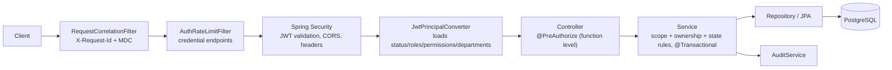
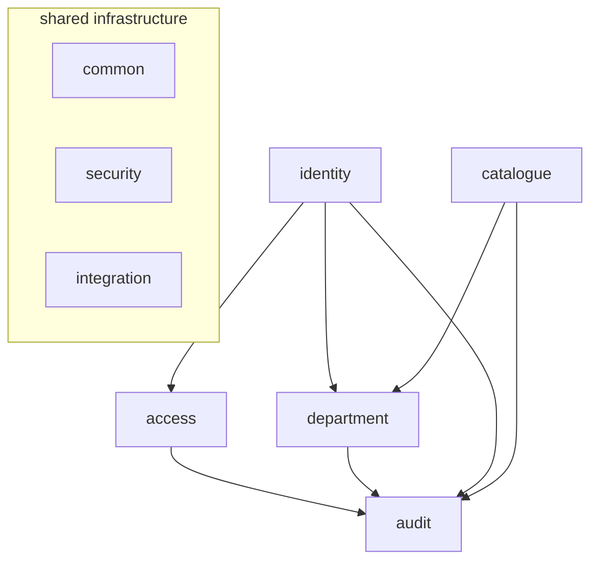

# Architecture (as implemented)

JanSetu is a **feature-oriented modular monolith** (ADR-001). It is one Spring Boot 3.5 application on Java 21 with one PostgreSQL system of record (ADR-002) and explicit module boundaries that are enforced by architecture tests.

> Portfolio simulation only. JanSetu is not an official government portal and has no real government integrations.

## Request path



Errors from any layer become RFC 9457 problem details through `GlobalExceptionHandler` (MVC) or `ProblemResponseWriter` (filters and security handlers).

## Packages

```text
com.jansetu
├── JanSetuApplication
├── config/            Clock, OpenAPI
├── common/            Small shared kernel
│   ├── api/           ApiResponse envelope, PageResponse, PageQuery (sort allowlist, size ≤ 100)
│   ├── error/         ErrorCode, ApiException, ProblemDetails, GlobalExceptionHandler
│   ├── web/           RequestCorrelationFilter, RequestIds, ClientInfo
│   ├── persistence/   AuditableEntity (UUID id, timestamps, @Version)
│   ├── crypto/        SecureTokens (random tokens, SHA-256)
│   └── idempotency/   IdempotencyService + record (Idempotency-Key)
├── security/          SecurityConfig, JWT keys/encoder/decoder, AccessTokenService,
│                      AuthenticatedUser (scope checks), PrincipalLoader port,
│                      problem-detail 401/403 handlers, AuthRateLimitFilter, Permissions
├── integration/email/ EmailDeliveryPort + logging adapter (local)
├── modules/
│   ├── audit/         Append-only audit log, audit search API
│   ├── access/        Roles, permissions, user_roles, privilege-escalation guard
│   ├── department/    Departments, department memberships (data scope)
│   ├── identity/      Users, auth (login/refresh/logout/reset), sessions, user admin,
│   │                  department staff management facade, PrincipalLoader impl
│   └── catalogue/     Services, requirements, immutable published versions, public catalogue
└── devseed/           Local-only synthetic seed data
```

Each module has `api` (controllers and DTOs), `service` (use cases, transactions, authorization), `domain` (JPA entities and enums with state rules) and `repository`. Its public surface is its `service` classes and the records they return.

**Mapping to the master prompt's package list.**
- `users`, `roles` and `permissions` live in `identity` and `access`, as the docs' domain boundaries prescribe (`BUSINESS_LOGIC.md` §1).
- `services` is `catalogue`, which avoids a name clash with Spring's "service" layer.
- `applications`, `documents`, `workflow`, `tasks`, `grievances`, `notifications`, `sla` and `analytics` already have database tables. Their modules are added in their own phases rather than as empty packages.

## Module dependency rules (enforced by `ArchitectureTest`)



1. **No cycles** between modules.
2. **Repositories stay private:** a repository is used only inside its own module. Other modules call its services.
3. **Controllers never touch repositories.**
4. **Shared infrastructure stays independent:** `common`, `security` and `integration` never depend on business modules. Security reaches identity through the `PrincipalLoader` port.
5. **Domain classes stay web-free:** they do not depend on Spring Web or the Servlet API.

Department staff management (`/departments/{id}/members`) is served by the identity module. It combines user data with memberships, and identity → department is the only allowed direction.

## Authentication and authorization

The full design is in ADR-005 and `docs/SECURITY.md`.

### Authentication

- **Passwords:** delegating password encoder (BCrypt by default; hashes upgrade transparently). Policy: 12–64 characters (≤ 72 bytes), at least one letter and one digit, not a common password, not containing the e-mail's local part.
- **Login protection:**
  - generic `INVALID_CREDENTIALS` errors;
  - a dummy hash comparison for unknown accounts, to equalise timing;
  - account lockout for 15 minutes after 5 failures;
  - per-client rate limit on the credential endpoints.
- **Access tokens:** RS256, 15 minutes, minimal claims; issuer, audience, signature, expiry and `token_use` are validated.
- **Refresh sessions:** opaque tokens stored hashed, rotated on every use, with reuse detection that revokes the whole family. Sent as an HttpOnly, SameSite=Strict cookie, plus the `X-JanSetu-Client` header as CSRF defence.
- **Revocation:** sessions can be revoked one device at a time or everywhere. Changing or resetting the password, or leaving the ACTIVE status, revokes all sessions. Access tokens issued before a password change are rejected.

### Authorization layers

| Layer | Mechanism |
|---|---|
| Function level | `@PreAuthorize("hasAuthority('RESOURCE:ACTION')")` on every protected endpoint; deny-by-default filter chain |
| Department scope | `AuthenticatedUser.requireDepartmentScope` in services; list queries are filtered by the actor's department ids unless the actor holds `SCOPE:ALL_DEPARTMENTS`; out-of-scope resources return **404** |
| Ownership and self-protection | users cannot change their own roles or status; session revocation is owner-only; citizens only reach `/auth/me` |
| Privilege escalation | roles that contain *privileged* permissions (`USER:*`, `ROLE:*`, `PERMISSION:*`, `SCOPE:ALL_DEPARTMENTS`, `DEPARTMENT:CREATE`) can only be granted, or put into custom roles, by actors who hold them; system-role permission sets are immutable via the API |
| Fresh authorities | roles, permissions, status and memberships are loaded per request, so changes apply immediately |

### Role overview

V8 holds the full matrix.

| Role | Scope | Highlights |
|---|---|---|
| CITIZEN | own records | create/submit applications, upload documents, raise grievances |
| OFFICER | member departments | read department applications, clarify, recommend, reject, verify documents, claim tasks |
| REVIEWER | member departments | approve/reject/complete applications |
| DEPARTMENT_ADMIN | member departments | update department, manage members, manage and publish services, assign tasks, SLA, department reports |
| PLATFORM_ADMIN | all departments | users, roles, departments, services platform-wide |
| AUDITOR | all departments, read-only | audit log search (itself audited) |
| MANAGEMENT_VIEWER | all departments, aggregates | department list, platform reports |

## Cross-cutting concerns

- **Transactions:** every mutating use case is one `@Transactional` service method. Audit records join the business transaction. Login and refresh keep their security side effects (lockout counters, family revocation) even when the request fails (`noRollbackFor`). E-mail is sent only after commit.
- **Concurrency:**
  - mutable aggregates carry `@Version`, and PATCH requests must include the version the client last saw (409 `STALE_VERSION`);
  - refresh-token and reset-token consumption use row locks;
  - unique constraints back every uniqueness rule.
- **Idempotency:** `POST /users`, `POST /departments` and `POST /services` accept an `Idempotency-Key`. A replay returns the original response; reusing a key with a different body returns 409. Records are kept for 24 hours.
- **API conventions:**
  - responses use the `{data, meta}` envelope;
  - pages carry `content`, `page`, `size`, `totalElements`, `totalPages`;
  - sorting uses an allowlist;
  - unknown JSON properties are rejected (mass-assignment protection);
  - DTOs are used everywhere and entities are never serialized.
- **Observability:**
  - the request id is in every log line, response header and error body;
  - Actuator health exposes liveness and readiness probes, and Micrometer exports Prometheus metrics;
  - logs are structured ECS JSON in staging and production;
  - Actuator runs on an internal management port in staging and production.
- **Configuration:** profiles `local`, `test`, `staging` and `production`. Every secret comes from environment variables; staging and production have no defaults and fail fast.

## Deliberate Phase 1 limitations

`IMPLEMENTATION_STATUS.md` has the full list.

- **Rate limiting is per instance:** counters are held in memory. Move them to Redis before scaling out.
- **No e-mail verification on registration.** Password-reset e-mails go to a logging adapter.
- **No MFA for privileged accounts.**
