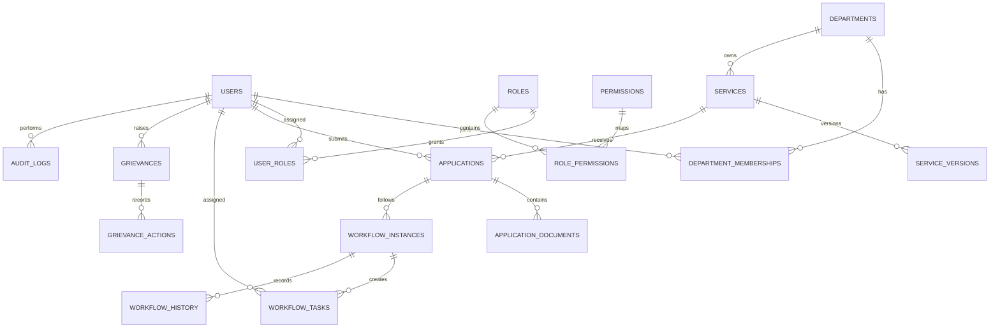

# Database Design

## 1. Database strategy

PostgreSQL is the transactional system of record. Start with one database and schema for the modular monolith. Use Flyway for all schema changes. Redis and MongoDB are optional additions, not requirements for the MVP.

## 2. Core tables

### Identity and access
- `users`
- `roles`
- `permissions`
- `user_roles`
- `role_permissions`
- `department_memberships`
- `refresh_sessions` (store hashed session/token identifiers, not raw refresh tokens)

### Organization and catalogue
- `departments`
- `services`
- `service_versions`
- `service_form_schemas`
- `service_required_documents`
- `workflow_definitions`
- `workflow_definition_versions`
- `sla_policies`
- `sla_policy_versions`

### Applications and workflow
- `applications`
- `application_answers` or versioned JSONB payload
- `application_documents`
- `workflow_instances`
- `workflow_tasks`
- `workflow_history`
- `application_decisions`
- `clarification_requests`

### Grievances
- `grievances`
- `grievance_assignments`
- `grievance_actions`
- `grievance_feedback`

### Platform operations
- `notifications`
- `notification_deliveries`
- `audit_logs`
- `outbox_events`
- `idempotency_records`
- `file_scan_records`

## 3. Relationship summary

## 4. Data type conventions

- Primary keys: UUID.
- Timestamps: `timestamptz`, persisted in UTC.
- Money, if introduced: `numeric(precision, scale)`, never floating point.
- State: constrained enum/reference value; choose PostgreSQL enum or varchar+check based on migration flexibility.
- Form answers: JSONB only for flexible, versioned form data; keep query-critical fields normalized.
- File size: bigint.
- Hash/checksum: varchar with algorithm identifier.
- Version: bigint for optimistic locking.

## 5. Constraints and indexes

Required constraints:
- Unique normalized user email where email is the login identifier.
- Unique application reference number.
- Unique grievance reference number.
- Foreign keys for all relationships.
- Not-null for required state, owner, service, timestamps.
- Check constraints for positive file size and valid numeric ranges.
- Unique idempotency key scoped by actor/operation as appropriate.

Candidate indexes (confirm with query plans):
- `applications(citizen_id, created_at desc)`
- `applications(department_id, status, submitted_at)`
- `applications(reference_number)`
- `workflow_tasks(assignee_id, status, due_at)`
- `workflow_tasks(department_id, status, due_at)`
- `grievances(department_id, status, created_at)`
- `audit_logs(resource_type, resource_id, occurred_at desc)`
- `notifications(user_id, read_at, created_at desc)`
- `outbox_events(status, next_attempt_at)`

Do not add every possible index. Measure write overhead and query plans.

## 6. Soft delete and retention

Do not soft-delete every table automatically. Use explicit lifecycle states for accounts/services and retention policies for personal data. Historical business records may need retention. Deletion/anonymization must consider legal obligations, audit requirements, foreign keys, backups, and data subject rights. Define per-entity policy before real deployment.

## 7. Migration rules

- One forward-only migration per logical schema change.
- Never edit a migration already applied to shared environments.
- Test migration from empty DB and from the previous release.
- Use expand-and-contract for incompatible changes.
- Back up before production migrations.
- Separate schema migration privileges from runtime application privileges where feasible.
