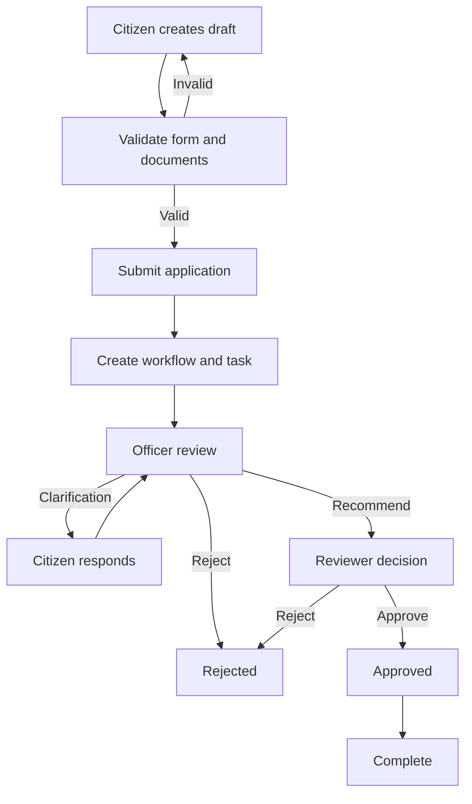

# Business Workflows and State Machines

## 1. Workflow principles

- State transitions are server-controlled.
- Every transition has an actor, permission, precondition, side effect, and history record.
- Workflow definitions are versioned.
- Existing instances remain associated with the definition version under which they started unless an explicit migration is executed.
- Critical changes occur transactionally.
- Events and notifications are delivered asynchronously after commit through an outbox when messaging is enabled.
- A workflow task is not equivalent to an application status; task status and case status are separate concepts.

## 2. Application lifecycle

### Primary states

`DRAFT → SUBMITTED → UNDER_REVIEW → PENDING_APPROVAL → APPROVED → COMPLETED`

Alternative paths:
- `UNDER_REVIEW → CLARIFICATION_REQUIRED → RESUBMITTED → UNDER_REVIEW`
- `UNDER_REVIEW → REJECTED`
- `PENDING_APPROVAL → REJECTED`
- `SUBMITTED/UNDER_REVIEW → WITHDRAWN` only if service policy permits and no irreversible decision has occurred.

Do not use a generic `CLOSED` state to hide whether the case was approved, rejected, withdrawn, or completed.

### Transition table

| From | Command | To | Actor / permission | Required data |
|---|---|---|---|---|
| DRAFT | submit | SUBMITTED | Owner / APPLICATION:SUBMIT | Complete form and documents |
| SUBMITTED | startReview | UNDER_REVIEW | Authorized queue worker | Assignment / workflow task |
| UNDER_REVIEW | requestClarification | CLARIFICATION_REQUIRED | Assigned officer / APPLICATION:CLARIFY | Question and due date/policy |
| CLARIFICATION_REQUIRED | respond | RESUBMITTED | Owner | Required response and files |
| RESUBMITTED | resumeReview | UNDER_REVIEW | Workflow engine/authorized officer | Valid response |
| UNDER_REVIEW | recommendApproval | PENDING_APPROVAL | Officer / APPLICATION:RECOMMEND | Recommendation |
| UNDER_REVIEW | reject | REJECTED | Authorized decision maker | Reason |
| PENDING_APPROVAL | approve | APPROVED | Reviewer / APPLICATION:APPROVE | Decision |
| PENDING_APPROVAL | reject | REJECTED | Reviewer / APPLICATION:REJECT | Reason |
| APPROVED | complete | COMPLETED | Authorized process / APPLICATION:COMPLETE | Completion evidence if required |
| DRAFT | withdraw | WITHDRAWN | Owner | Optional reason |

The exact transition set is service-configurable but must be constrained to supported transition types and validated by the backend.

## 3. Application submission sequence

1. Client sends submit command with application ID and optional idempotency key.
2. API authenticates user.
3. Authorization verifies ownership and service eligibility.
4. Application service loads the draft with appropriate locking/version check.
5. Validator checks form schema version, required fields, document checklist, file verification status, and service availability.
6. Workflow policy selects the initial workflow definition version and department queue.
7. One database transaction:
   - changes application state;
   - records submitted timestamp;
   - creates workflow instance and initial task;
   - appends business history;
   - appends audit record;
   - stores outbox event if asynchronous delivery is enabled.
8. Transaction commits.
9. Event publisher sends outbox event; consumers process idempotently.
10. API returns reference number and current state.

Failure before commit means no partial submission. External notifications must not be sent before the transaction commits.

## 4. Clarification workflow

1. Assigned officer opens task.
2. Backend checks assignment, department scope, task state, and permission.
3. Officer submits a clear question, requested evidence, and policy-defined response deadline.
4. Transaction updates task and application state, writes history/audit, and writes notification outbox event.
5. Citizen receives an in-app notification.
6. Citizen responds and uploads permitted files.
7. Backend validates the response and updates the task/workflow.
8. Application returns to the configured review queue.

## 5. Approval workflow

- Officer recommendation and final approval may be separate stages.
- The same user must not perform incompatible stages if separation-of-duties policy is enabled.
- Approver sees application details, verified documents, prior decisions, and permitted notes.
- Approval/rejection requires a decision reason or structured decision code according to service policy.
- State transition uses optimistic locking or a conditional update to prevent two simultaneous decisions.
- The final decision is visible to the citizen according to disclosure policy.

## 6. Grievance lifecycle

Suggested states:
`OPEN → ASSIGNED → IN_PROGRESS → RESPONSE_PROVIDED → RESOLVED`

Appeal path:
`RESOLVED → APPEALED → APPEAL_REVIEW → RESOLVED` or `CLOSED`.

Rules:
- A grievance receives a unique reference.
- Category-to-department routing is configurable.
- Assignment and reassignment are audited.
- Internal notes are never exposed to citizens.
- Public responses are explicitly marked and sanitized.
- Appeal eligibility and time window are configurable.
- Reopening must be policy-controlled and audited.

## 7. SLA workflow

1. On entry to a timed stage, calculate deadline from the active SLA policy version.
2. Use a business calendar if business days/hours are required.
3. Persist deadline and policy version on the case/task.
4. Scheduler finds due items using indexed bounded batches.
5. Scheduler claims work safely to avoid concurrent duplicate processing.
6. Escalation record is created with a unique idempotency key.
7. Supervisor notification is queued.
8. Repeated scheduler runs do not duplicate the same escalation.
9. Pause/resume rules for clarification or citizen wait time must be explicit.

## 8. Document verification workflow

`UPLOADED → QUARANTINED → SCANNING → AVAILABLE` or `REJECTED`.

- File is not downloadable while quarantined/scanning.
- Validate size, extension allowlist, MIME type, and file signature.
- Scan for malware when scanner integration is enabled.
- Store using a random object key.
- Persist checksum, size, detected media type, uploader, and scan status.
- Download requires authorization and a short-lived access mechanism.
- Rejected files retain only metadata necessary for audit/retention policy.

## 9. Task lifecycle

`OPEN → CLAIMED/ASSIGNED → IN_PROGRESS → COMPLETED`

Alternative: `CANCELLED`, `REASSIGNED`, `BLOCKED`.

Task assignment must be atomic. Task completion must validate that the task is still active and that the actor remains authorized.

## 10. Workflow history vs audit log

- Business history explains the case timeline to authorized users.
- Audit log records security-sensitive and administrative actions for accountability.
- They may share an event identifier but serve different audiences and retention policies.
- Do not expose internal audit metadata to citizens by default.

## 11. Mermaid overview

